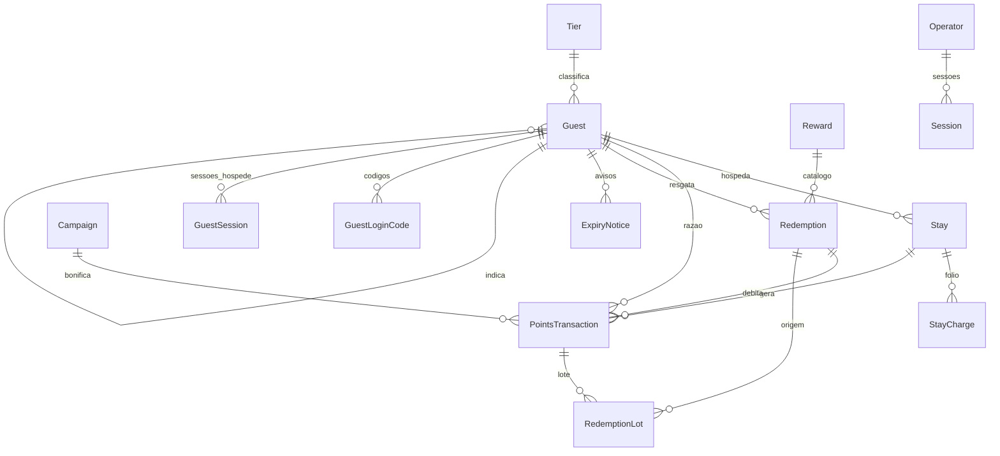

# Modelo de dados

Fonte da verdade: `prisma/schema.prisma`. Este documento é um resumo.

## Tabelas
| Tabela | Para quê |
|---|---|
| `Tier` | Níveis (Bronze, Prata, Ouro, Diamante), limiar e multiplicador |
| `Guest` | Hóspede cadastrado; nível, validade do nível, indicação, consentimentos |
| `Stay` / `StayCharge` | Estadia e folio por categoria (diária, A&B, spa, eventos, outros) |
| `PointsTransaction` | Razão de pontos; créditos são lotes com `remaining` e `expiresAt` (os pontos valem até o fim do dia do hotel, ADR 0016) |
| `Reward` / `Redemption` | Catálogo de prêmios e resgates (PENDING → CONFIRMED → USED, ou CANCELLED) |
| `RedemptionLot` | De quais lotes saíram os pontos de cada resgate (para devolver ao cancelar) (ADR 0009) |
| `ExpiryNotice` | Fila de avisos de pontos a vencer (90 e 30 dias); a rotina noturna grava, o envio ainda não existe (ADR 0008) |
| `Campaign` | Campanhas de bônus (tabela pronta; regra ainda não implementada) |
| `Operator` | Funcionário com login; senha só como hash scrypt, papel, tentativas falhas e trava (ADR 0010) |
| `Session` | Sessão de login; guarda só o hash do token; dura 12 horas (ADR 0010) |
| `GuestLoginCode` | Código de acesso do hóspede à "Minha conta"; só o hash, 10 minutos, 5 tentativas (ADR 0013) |
| `GuestSession` | Sessão do hóspede na "Minha conta"; só o hash do token; dura 24 horas; separada da sessão de funcionário (ADR 0013) |
| `AuditLog` | Quem fez o quê e quando; só ids e contagens, nunca dados pessoais; sem vínculo com `Operator` para o histórico sobreviver (ADR 0010) |

## Princípios
- **Razão imutável**: PointsTransaction nunca é editada; erros viram REVERSAL/ADJUST.
- **Saldo utilizável** = soma do que resta (`remaining`) nos lotes ainda válidos (ADR 0009). A soma simples dos lançamentos inclui pontos vencidos que a rotina noturna ainda não tirou, e por isso não serve como saldo.
- **Lotes**: créditos têm `remaining` e `expiresAt` (24 meses); débitos consomem FIFO, o que vence antes sai primeiro (`src/domain/points/expiry.ts`).
- **Nível** usa `qualifyingPts`: só os pontos-base, sem multiplicador nem bônus.
- **Idempotência**: `idempotencyKey` único evita crédito duplicado; `requestId` único evita resgate duplicado.
- **Folio por categoria** (StayCharge) permite pontuar A&B/SPA/Eventos e medir receita por área.
- **Documento (CPF/passaporte)**: `Guest.document` guarda só o HMAC-SHA256 com chave secreta; `documentLast4` guarda os 4 últimos caracteres para exibir (ADR 0006). O CPF completo não fica no banco.
- **LGPD**: `marketingConsent`/`consentAt`, `deletedAt` para anonimização (rota ainda não existe).
- **Restrições no banco** (saldo do lote nunca negativo nem acima do creditado etc.) ficam na migração `prisma/migrations/*_constraints`.

## Dados para marketing
Recência/frequência/valor (RFM), ticket médio por categoria, % reserva direta vs OTA, perfil de viagem, aniversariantes do mês, pontos a vencer em 30/90 dias, hóspedes perto do próximo nível, taxa de resgate, origem dos cadastros, LTV por nível.
