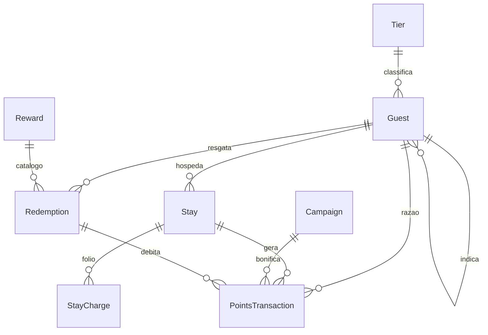

# Modelo de dados

## Princípios
- **Razão imutável**: PointsTransaction nunca é editada; erros viram REVERSAL/ADJUST. Saldo = soma.
- **Lotes**: créditos têm `remaining` e `expiresAt`; débitos consomem FIFO (`src/domain/points/expiry.ts`).
- **Idempotência**: `idempotencyKey` único evita crédito duplicado em reimportações do PMS.
- **Folio por categoria** (StayCharge) permite pontuar A&B/SPA/Eventos e medir receita por área.
- **LGPD**: `marketingConsent`/`consentAt`, `deletedAt` para anonimização; `document` deve ser protegido.

## Dados para marketing
Recência/frequência/valor (RFM), ticket médio por categoria, % reserva direta vs OTA, perfil de viagem, aniversariantes do mês, pontos a vencer em 30/90 dias, hóspedes perto do próximo nível, taxa de resgate, origem dos cadastros, LTV por nível.
